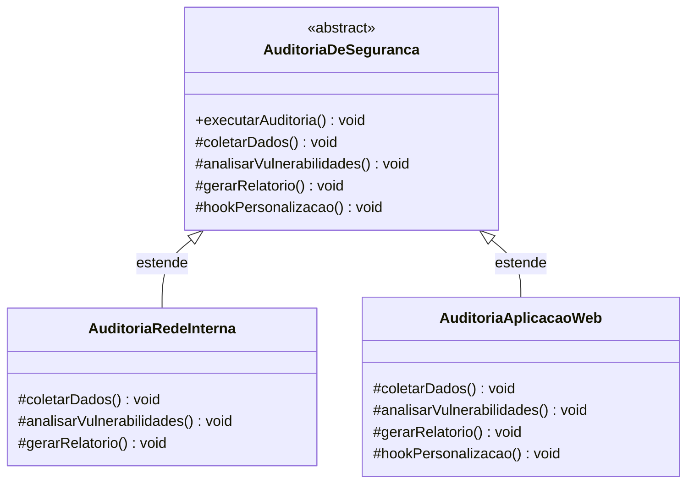

# Padrão Template Method - Pipeline de Auditoria de Segurança

Implementação do padrão de projeto **Template Method** (Comportamental) em Java. O projeto demonstra como definir o esqueleto (macro) de um algoritmo em uma classe abstrata, delegando a implementação de passos específicos para as subclasses, permitindo que elas redefinam certas etapas sem alterar a estrutura geral do algoritmo.

##  Descrição

### O Problema
Em um SOC (Security Operations Center), diferentes tipos de auditoria de segurança (ex: Auditoria de Rede Interna vs. Auditoria de Aplicação Web) compartilham o mesmo fluxo macro de execução:
1. Coletar dados do alvo.
2. Analisar vulnerabilidades específicas.
3. Gerar um relatório padronizado.

Implementar esse fluxo duplicando o código em cada classe de auditoria viola o princípio **DRY (Don't Repeat Yourself)**. Por outro lado, usar um único método gigante com `if/else` para cada tipo de auditoria viola o **Princípio Aberto/Fechado (OCP)** e a **Responsabilidade Única (SRP)**.

### A Solução
O padrão Template Method inverte o controle (Princípio de Hollywood: *"Não nos ligue, nós ligaremos para você"*). A classe abstrata `AuditoriaDeSeguranca` define o algoritmo final (o *template*) como `final`, garantindo que a ordem dos passos nunca seja alterada pelas subclasses. As subclasses apenas implementam os passos abstratos específicos do seu domínio.

## Estrutura do Projeto

```bash
src/
├── main/
│   └── padroescomportamentais/templatemethod/
│       ├── AuditoriaDeSeguranca.java      ⁦(Classe Abstrata / Template)⁩
│       ├── AuditoriaRedeInterna.java      ⁦(ConcreteClass A)⁩
│       └── AuditoriaAplicacaoWeb.java     ⁦(ConcreteClass B)⁩
│
└── test/
└── padroescomportamentais/templatemethod/
└── AuditoriaDeSegurancaTest.java  ⁦(Casos de teste)⁩
```

## Diagrama de Classes

O diagrama abaixo ilustra a relação de herança e a proteção do método template.



## Análise Crítica: Vantagens e Pontos Cegos

### Vantagens (Fatos)
*   **Reutilização de Código:** A lógica comum (o esqueleto do algoritmo) fica centralizada na superclasse, eliminando duplicação.
*   **Inversão de Controle (Princípio de Hollywood):** A superclasse chama os métodos das subclasses, e não o contrário. Isso garante que o fluxo macro seja respeitado.
*   **Controle de Extensão:** O uso da palavra-chave `final` no método template impede que subclasses modifiquem a ordem ou a lógica central do algoritmo.

### Pontos Cegos e Contrapontos (Onde o padrão exige cuidado)
1.  **Acoplamento por Herança (Rigidez):**
    *   *Fato:* O Template Method depende de herança. Mudanças no método template na superclasse impactam automaticamente todas as subclasses.
    *   *Contraponto:* Em hierarquias muito profundas, isso pode causar efeitos colaterais difíceis de rastrear. Se a variação for muito complexa, composições (como o padrão **Strategy**) podem ser mais flexíveis.
2.  **Métodos "Hook" (Ganchos) Mal Utilizados:**
    *   *Fato:* O padrão permite métodos `hook` (com implementação vazia na superclasse) para que subclasses insiram comportamentos opcionais.
    *   *Contraponto:* O abuso de hooks torna o fluxo do algoritmo imprevisível e difícil de depurar, pois a superclasse não tem garantia de que o hook foi sobrescrito ou qual será seu efeito colateral.

## Diferença Crucial: Template Method vs. Strategy

Esta é a confusão mais comum em provas e revisões de código, pois ambos lidam com a variação de algoritmos.

| Característica | Padrão Template Method | Padrão Strategy |
| :--- | :--- | :--- |
| **Mecanismo** | **Herança** (Subclasses sobrescrevem passos). | **Composição** (Objeto Strategy é injetado). |
| **Escopo da Variação** | Varia **partes** de um algoritmo maior. | Substitui o **algoritmo inteiro**. |
| **Controle do Fluxo** | A Superclasse controla o fluxo (método `final`). | O Cliente controla qual algoritmo usar. |
| **Tempo de Mudança** | Definido em tempo de **compilação** (herança fixa). | Pode ser trocado em tempo de **execução**. |
| **Exemplo** | Fluxo de auditoria (coletar -> analisar -> reportar). | Escolher entre Criptografia AES ou RSA. |

##  Testes

O projeto contém testes unitários (JUnit 5) que validam:
*   O método template (`executarAuditoria`) executa os passos na ordem correta.
*   As subclasses fornecem as implementações específicas sem alterar o fluxo macro.
*   O método template é `final` e não pode ser sobrescrito (validado via reflexão ou tentativa de compilação).
*   Os métodos *hook* opcionais são executados apenas quando sobrescritos.

## Tecnologias Utilizadas

| Tecnologia | Versão | Finalidade no Projeto |
| :--- | :--- | :--- |
| **Java** | 21 | Linguagem de programação principal |
| **Maven** | 3.9+ | Gerenciamento de dependências e automação de build |
| **JUnit 5** | 5.9.x | Framework para execução dos testes unitários |
| **Draw.io** | Web | Criação e exportação dos diagramas UML |
